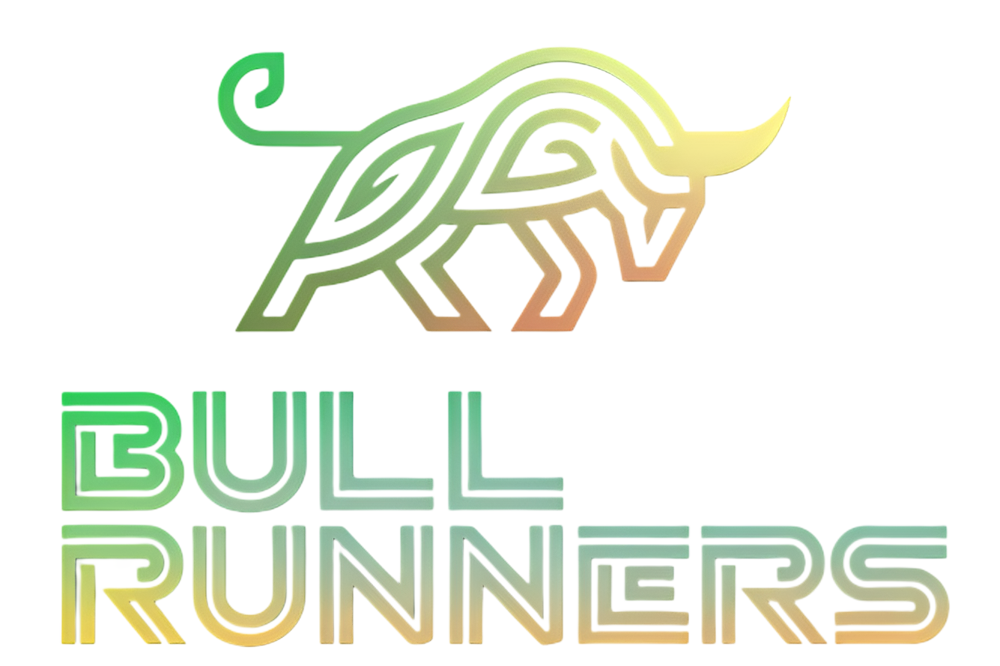

<a name="readme-top"></a>

<div align="center">
  
  <br>
  <br>
  <p align="center">
    Full-stack crypto portfolio tracker built with the <strong>MERN</strong> stack, containerized with <strong>Docker</strong> and deployed on <strong>AWS</strong> via <strong>Terraform</strong> and <strong>GitHub Actions CI/CD</strong>.
    <br />
    <a href="#about-the-project"><strong>Explore the documentation »</strong></a>
    <br />
    <br />
    <a href="#architecture-overview">View Architecture</a>
    ·
    <a href="#setup-instructions">Setup Guide</a>
    ·
    <a href="https://github.com/szabodorka/mern-docker-project/issues">Report Issue</a>
  </p>
</div>

---

## Table of Contents

- [About the Project](#about-the-project)
- [Tech Stack](#tech-stack)
- [Architecture Overview](#architecture-overview)
- [Setup Instructions](#setup-instructions)
  - [1. Prerequisites](#1-prerequisites)
  - [2. Terraform Infrastructure](#2-terraform-infrastructure)
  - [3. GitHub Secrets](#3-github-secrets)
  - [4. CI/CD Workflow](#4-cicd-workflow)
- [Usage](#usage)
- [Limitations & Notes](#limitations--notes)

---

## About the Project

This crypto portfolio tracker was originally developed as a **team project** during a full-stack developer course.  
The original frontend and backend codebases were built collaboratively and the build process is included in the commit history.

In this repository, the focus has been on **optimizing and extending the existing application** by adding:

- **Docker containerization** of backend and frontend
- A minimal **Terraform infrastructure** for AWS provisioning (EC2, Security Groups, IAM, OIDC)
- A complete **GitHub Actions CI/CD pipeline** using OIDC authentication

---

## Tech Stack

### **Backend**

[](https://nodejs.org/)
[](https://expressjs.com/)
[](https://www.mongodb.com/atlas/database)
[](https://mongoosejs.com/)

### **Frontend**

[](https://react.dev/)
[](https://vitejs.dev/)
[](https://developer.mozilla.org/docs/Web/JavaScript)

### **Infrastructure**

[](https://aws.amazon.com/)
[](https://www.terraform.io/)
[](https://www.docker.com/)
[](https://docs.github.com/actions)

---

## Architecture Overview

- **Frontend (React + Nginx)** → served on an AWS EC2 instance, load-balanced via AWS NLB
- **Backend (Express API)** → runs as a Docker container on the same host, available under `/api`
- **Database (MongoDB Atlas)** → secure managed service, IP-whitelisted for EC2
- **Infrastructure** → provisioned with Terraform (EC2, SGs, NLB, IAM, OIDC provider)
- **CI/CD** → GitHub Actions builds Docker images → pushes to ECR → deploys via SSM command

<p align="right">(<a href="#readme-top">back to top</a>)</p>

---

## Setup Instructions

### 1. Prerequisites

- AWS account with permissions to create:
  - ECR repositories
  - IAM roles & OIDC provider
  - EC2, Security Groups and NLB
- Default VPC in your region or in the default region `eu-central-1`
- Backend & Frontend ECR repository in the same region
- Terraform `>= 1.5`
- GitHub repository for this project
- MongoDB Atlas cluster (with `MONGO_URI` and whitelisted EC2 Public IP)
- Coingecko API Key (`COINGECKO_KEY`)

---

### 2. Terraform Infrastructure

1. Clone the repo and switch to the terraform folder:

```bash
git clone https://github.com/<your-username>/<your-repo>.git
cd <your-repo>/terraform
```

Create terraform.tfvars file to define sensitive variables:

```hcl
ecr_repo_frontend = "mern-docker-frontend"
ecr_repo_backend = "mern-docker-backend"
mongo_uri = "your-mongodb-uri"
coingecko_key = "your-coingecko-key"
github_owner = "your-github-username"
github_repo = "your-github-repo-name"
```

Initialize and apply:

```bash
terraform init
terraform apply
```

This will create:

- EC2 instance (Ubuntu 24.04, with Docker, AWS CLI, SSM Agent installed) > Add EC2 public IP to the whitelist of your MongoDB cluster
- IAM role for GitHub OIDC
- Security Groups & Network Load Balancer

<strong>Note: ECR repositories must exist beforehand</strong>

---

### 3. GitHub Secrets

Add the following repository secret from Terraform outputs under Git repository Settings > Secrets and variables > Actions:

AWS_ROLE_ARN - The ARN of the OIDC role created by Terraform (e.g., arn:aws:iam::<account_id>:role/gh-actions-mern-docker)

---

### 4. CI/CD Workflow

On push to main, GitHub Actions will:

- Assume the OIDC role in AWS
- Build backend & frontend Docker images
- Push them to ECR
- Trigger SSM command on EC2 > docker compose pull && docker compose up -d

<p align="right">(<a href="#readme-top">back to top</a>)</p>

---

## Usage

Access the application via the NLB DNS name printed in Terraform outputs.
API base path is /api.

## Limitations & Notes

- Requires existing ECR repositories
- MongoDB Atlas must have EC2 IP whitelisted
- Single EC2 host – no auto-scaling yet
